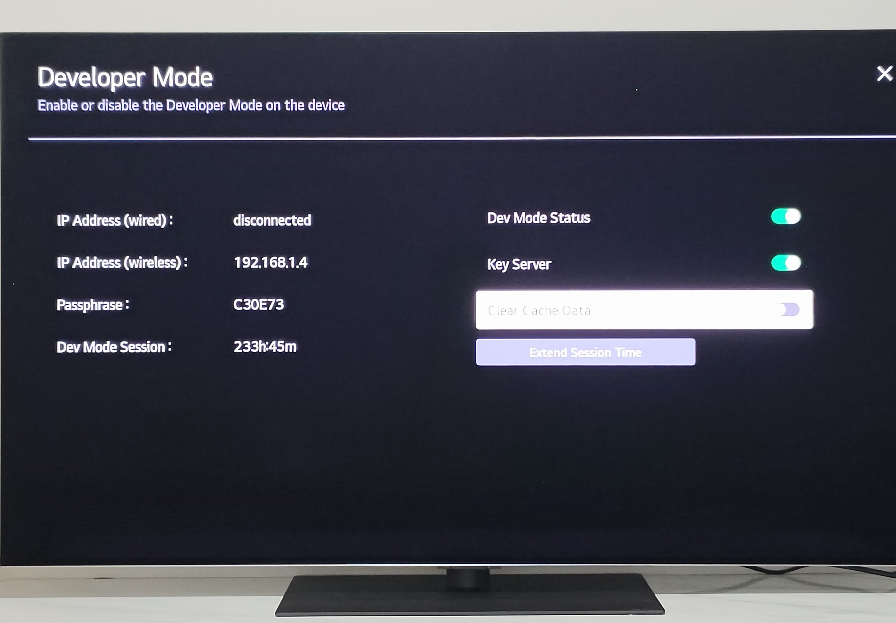
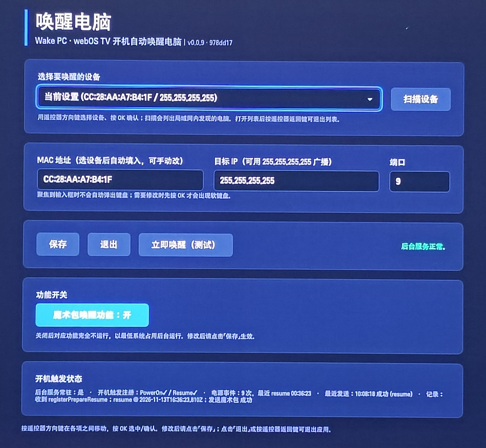

# 唤醒电脑（Wake PC）

在 LG webOS 电视上，**开机后自动向局域网内的电脑发送 Wake-on-LAN 魔术包**，实现「电视一开机，电脑就被唤醒」。
- **适用平台**：webOS TV（已实测 LG G6 / webOS 26 中国版固件，开发者模式）
- **License**：[MIT](./LICENSE)

---

## 功能特性

- **开机自动唤醒**：电视开机（冷启动）或从待机快速恢复（快速启动+）后，自动发送一次魔术包,唤醒局域网电脑。
- **遥控器友好**：方向键 + OK + 返回即可完成全部操作，下拉列表、输入框均做了焦点管理。

## 快速开始

### 前置条件

1. **电视**：LG webOS 电视已开启 **开发者模式**（安装 Developer Mode 应用、Dev Mode Status 为 ON），并记录开发者模式界面左下角的 6 位 Passphrase。



2. **电脑**：与电视处于同一局域网，已安装 **Node.js** 与 **@webos-tools/cli**：

```bash
npm install -g @webos-tools/cli
```

### 一键部署

```powershell
powershell -NoProfile -ExecutionPolicy Bypass -File .\deploy.ps1
```

脚本会自动完成：检查 ares CLI → 定位本地网卡 → 测试电视连通性 → 启动本地中继并指向电视 → 获取 SSH 密钥 → 打包（注入提交哈希）→ 安装 → 启动应用。

---

## 使用方式

1. 在电视上打开 **唤醒电脑** 应用。
2. 点 **「扫描设备」** 让电视自动列出局域网内在线电脑，选择目标；或直接在 **MAC 地址 / 目标 IP / 端口** 中手动填写。
3. 点 **「保存」** 写入配置。
4. 点 **「立即唤醒（测试）」** 验证电脑能被唤醒。
5. 之后电视每次开机，都会自动唤醒这台电脑。


